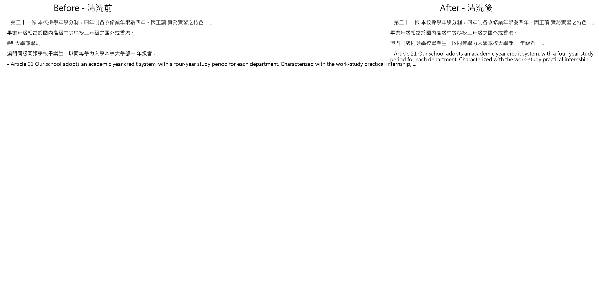
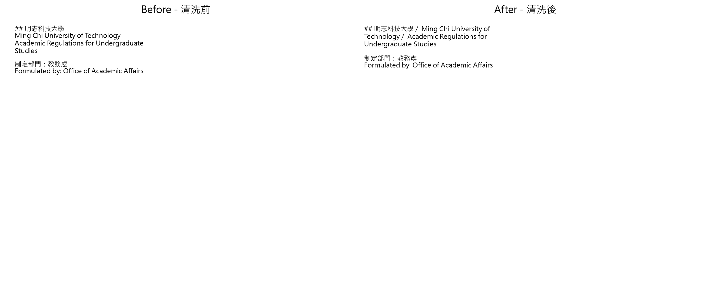
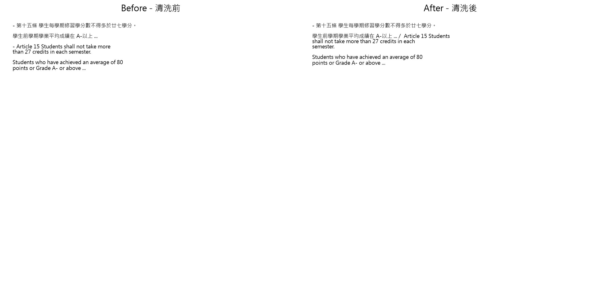
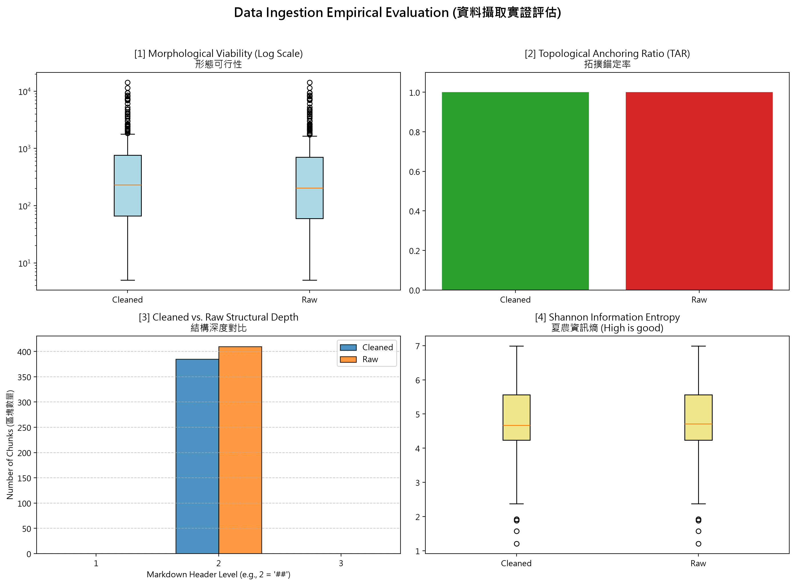
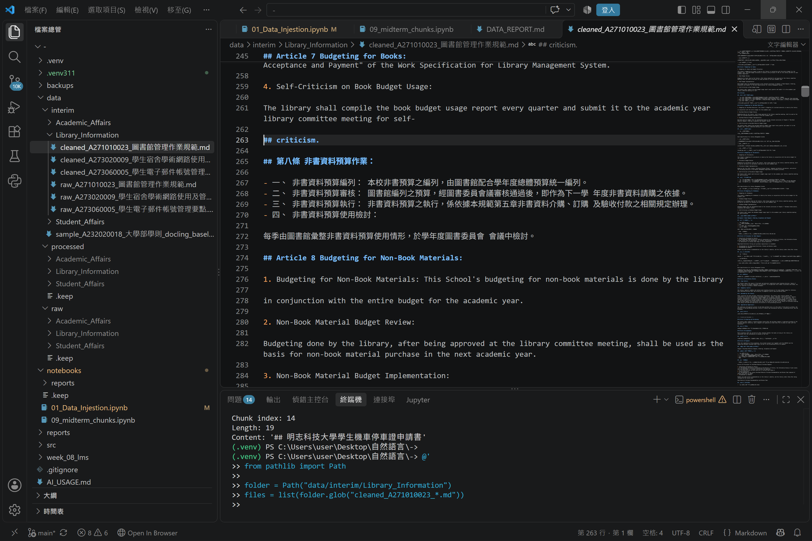

# 資料前處理報告 (Data Preparation Report)

> 期中評量 · NLP 自然語言處理 115-S1
>
> 本報告依照實際執行結果整理，保留老師的原始題目與評分要求，並加入人工查證內容。

- **學號 / 姓名**：U12627003 / 王威翔
- **專案名稱**：Week 08 PDF 資料前處理與 Week 09 期中資料品質分析

- **完成的任務**：
  - [x] 1-A 頁首頁尾清除：程式實作與批次執行完成
  - [x] 1-B 雙語標題合併：程式實作與批次執行完成
  - [x] 1-C 雙語條文合併：程式實作與批次執行完成

以上代表三項程式均已實作及執行，不代表所有真實文件的清洗結果皆已人工驗證無誤。

---

## 1. 資料集概覽 (Dataset Overview)

> 數字來源：`01_Data_Injestion.ipynb` 第 2 節（掃描 PDF）與第 5 節（批次處理）的輸出。

| 類別 (Cluster) | PDF 數量 | 清洗前 chunk 數 | 清洗後 chunk 數 |
|---|---:|---:|---:|
| Academic_Affairs | 3 | 96 | 91 |
| Library_Information | 3 | 248 | 233 |
| Student_Affairs | 3 | 66 | 61 |
| **合計** | **9** | **410** | **385** |

### 實際資料處理成果

本次資料集共有九份 PDF，分成三個類別，每個類別各有三份文件。

透過 Docling 完成 PDF 解析、Markdown 清洗、拓撲感知切塊及 JSON 輸出。

已確認產生：

- Raw Markdown：9 份。
- Cleaned Markdown：9 份。
- Raw JSON：9 份。
- Cleaned JSON：9 份。

總計 36 份 Markdown 與 JSON 輸出檔案。

### Chunk 數量比較

| 類別 | Raw chunks | Cleaned chunks | 減少數量 |
|---|---:|---:|---:|
| Academic_Affairs | 96 | 91 | 5 |
| Library_Information | 248 | 233 | 15 |
| Student_Affairs | 66 | 61 | 5 |
| **總計** | **410** | **385** | **25** |

清洗後共減少 25 個 Chunk，減少比例約為 6.10%。

### 老師的問題

**問題 (2–3 句)：** 清洗後 chunk 數量變少了多少？是哪個任務造成的？有沒有哪個任務**不影響** chunk 數量？為什麼？

> 提示：chunk 是用什麼規則切開的？請看 notebook 第 5 節的 `chunking_regex`。

### 我的回答

本次九份 PDF 的 Raw Chunk 數量為 410 個，Cleaned Chunk 數量為 385 個，共減少 25 個，約減少 6.10%。

本次切塊使用的正則表示式為 `r"\n(?=##\s)"`，代表主要依照 Markdown 二級標題建立新的 Chunk。因此，1-A 移除多餘標題或 1-B 合併雙語標題時，都可能改變 Chunk 數量。

1-C 主要整理雙語條文內容，通常不會直接改變二級標題數量，因此可能不影響 Chunk 數量。

以《大學部學則》的逐階段測試為例，Raw 原本有 43 個 Chunk，執行 1-A 後減少為 40 個，後續測試的 1-B 與 1-C 沒有再改變該次測試的 Chunk 數量。

不過，整體九份文件的 25 個 Chunk 減少量，是三個任務共同處理後的結果，不能直接將全部減少量歸因於單一任務。

---

## 2. 清洗步驟 (Cleaning Steps)

### 老師的截圖要求與提示

> **截圖來源：** `data/interim/<類別>/` 中的 `raw_*.md`（清洗前）與 `cleaned_*.md`（清洗後），也就是批次處理存下的真實檔案。
>
> **[重要] 不可使用 notebook 中的範例。** Notebook 任務 1-A、1-B、1-C 的測試文字（第二十一條、明志科技大學 / Ming Chi University of Technology、第十五條 / Article 15）不能作為你的截圖。請在真實檔案中另找一處。使用範例的截圖不給分。
>
> **截圖方法 (VS Code 比較檢視)：**
>
> 1. 在檔案總管對 `raw_<檔名>.md` 按右鍵 → Select for Compare。
> 2. 對同一份文件的 `cleaned_<檔名>.md` 按右鍵 → Compare with Selected。
> 3. 左右並排顯示，紅色 = 刪除，綠色 = 新增或修改。按 `Ctrl + F` 搜尋，找到該任務造成的變更。
> 4. 每個任務截一張圖，存到 `reports/figures/`，檔名必須完全相同：
>    - 任務 1-A → `1a_compare.png`
>    - 任務 1-B → `1b_compare.png`
>    - 任務 1-C → `1c_compare.png`

### 2.1 任務 1-A：頁首頁尾溢出清除

- **檔名：** `cleaned_A231060004_學生申請期中停修課程實施要點.md`
- **搜尋的文字：** `學生申請期中停修課程實施要點`
- **截圖（存為 `reports/figures/1a_compare.png`）：**



**老師的問題：改變了什麼？**

**我的回答：**

1-A 的目的是清除 PDF 解析後，混入正文的頁首、頁尾或重複文件名稱。

程式先從 PDF 檔名取得法規標題，再透過正則表示式辨識可能重複出現的標題文字。

由於 PDF 每頁可能重複印出相同的文件名稱，如果沒有清理，就可能將頁首內容錯誤判定為新的章節。

在《大學部學則》的逐階段測試中，執行 1-A 後 Chunk 數量由 43 減少為 40，顯示部分標題邊界已受到清洗規則影響。

**老師的問題：這對之後的問答檢索有什麼幫助？**

**我的回答：**

移除重複頁首頁尾可以降低檢索雜訊，避免模型反覆取得相同的文件名稱、頁碼或其他排版資訊。

這可以讓 Chunk 更集中於實際條文內容，增加後續校規問答系統取得有效資訊的機會。

**老師的問題：這個任務有沒有改錯的地方（把不該改的也改了）？若有，寫出檔名與搜尋的文字；若沒有，寫「沒有發現」。**

**我的回答：**

目前沒有足夠證據確認 1-A 誤刪了必要條文。

不過，仍需利用最新版 Raw 與 Cleaned 的比較畫面，確認正式文件標題是否被不當移除。

先前檢查時曾發現重複文件名稱殘留的情況，這屬於清洗不完全，不代表已經證實發生誤刪。

---

### 2.2 任務 1-B：雙語標題合併

- **檔名：** `cleaned_A232020018_大學部學則.md`
- **搜尋的文字：** `明志科技大學` 及 `Ming Chi University of Technology`，以及 `大學部學則` 及其英文標題。
- **截圖（存為 `reports/figures/1b_compare.png`）：**



**老師的問題：改變了什麼？**

**我的回答：**

1-B 的目的是處理中英文雙語標題因 PDF 排版而被分成兩個 Markdown 標題的問題。

例如原本中文與英文標題可能分別占用一行，而且兩行都以 `##` 開頭。若直接切塊，就可能將原本屬於同一章節的兩個標題拆開。

透過正則表示式的捕捉群組，可以將符合條件的雙語標題合併，中間以 `/` 分隔。

在《大學部學則》的額外測試中，我發現原本的規則無法處理中英文標題之間存在空白行的情況。

因此另外測試允許空白行、並限制中文標題接英文標題的規則，成功合併 16 組雙語標題，使該次改善測試結果由 40 個 Chunk 減少至 24 個。

這是額外改善測試的結果，並非目前九份 PDF 正式批次輸出的數字，兩者不能混用。

**老師的問題：這對之後的問答檢索有什麼幫助？**

**我的回答：**

合併雙語標題後，中文與英文可以保留在同一個 Chunk 中。

當使用者使用中文或英文查詢相關規定時，檢索系統比較容易找到同一個章節，減少因標題斷裂而造成的資訊不足。

**老師的問題：這個任務有沒有改錯的地方（把不該改的也改了）？若有，寫出檔名與搜尋的文字；若沒有，寫「沒有發現」。**

**我的回答：**

在未限制語言條件的改善測試中，曾出現不合理合併與多餘 `##` 符號的風險。

因此，我認為不能只用合併次數或 Chunk 減少數量判斷成功，還必須人工確認中英文標題是否互相對應。

目前尚未全面驗證九份文件的所有標題，不能認定完全沒有誤合併。

---

### 2.3 任務 1-C：雙語條文合併

- **檔名：** `cleaned_A232020018_大學部學則.md`
- **搜尋的文字：** 中文條文編號及相鄰英文條文。
- **截圖（存為 `reports/figures/1c_compare.png`）：**



**老師的問題：改變了什麼？**

**我的回答：**

1-C 的目的是將原本應該互相對應的中文條文與英文條文整理在一起，改善 PDF 轉換造成的段落斷裂問題。

程式透過正則表示式辨識中文條文編號與英文 `Article` 條文格式，嘗試保留兩種語言之間的對照關係。

此外，規則需要避免把兩個不同的中文條文誤合併，否則可能造成法規結構錯誤。

本次已完成 Notebook 的基本測試及批次清洗，但仍需要確認實際比較截圖中的案例不是老師 Notebook 所提供的 Article 15 範例。

**老師的問題：這對之後的問答檢索有什麼幫助？**

**我的回答：**

法規問答系統需要保留正確的條文內容與編號。

如果中英文條文被拆開，模型可能只取得部分內容；若能保持兩種語言對應關係，就能提升檢索結果的完整性。

**老師的問題：這個任務有沒有改錯的地方（把不該改的也改了）？若有，寫出檔名與搜尋的文字；若沒有，寫「沒有發現」。**

**我的回答：**

目前尚未從實際檔案確認 1-C 出現誤刪或誤合併，但現有證據也不足以保證完全沒有錯誤。

尤其是涉及不同條文編號的情況，若誤將相鄰的不同條文合併，可能影響後續問答的正確性。

因此，仍須在實際文件中選擇非老師測試範例的條文，核對清洗前後的內容。

---

## 3. 評估指標與 AI 解讀查證 (Metrics & Verifying the AI's Interpretation)

### 3.1 指標數據表

> 數字來源：專案根目錄的 `metrics.json`。[1]、[2] 必填；[3]、[4] 選填。
>
> 「參考值」由老師在課堂上公布（完成全部任務的結果）。

| 指標 | Raw | Cleaned（你的） | Cleaned（參考值） |
|---|---:|---:|---|
| [1] 中位數長度 Median Length | 204.0 | 230.0 | 待老師公布 |
| [2] 拓撲錨定率 TAR | 100.00% | 100.00% | 待老師公布 |
| [3] 深度變異量 SDV（選填） | 0.00 | 0.00 | 待老師公布 |
| [4] 中位數資訊熵 Entropy（選填） | 4.7149 | 4.6731 | 待老師公布 |

### 實際數據來源

本次使用 `01_Data_Injestion.ipynb` 第 6 節的 Python 程式，對全部 Raw 與 Cleaned Chunk 計算評估指標。

結果已儲存到專案根目錄的 `metrics.json`。

評估結果顯示：

1. Cleaned 的 Chunk 長度中位數由 204 增加至 230，增加 26 字元。
2. Raw 與 Cleaned 的 TAR 均達 100%。
3. Raw 與 Cleaned 的 SDV 均為 0。
4. Cleaned 的資訊熵中位數由 4.7149 降至 4.6731，減少約 0.0418。

> **儀表板截圖：** `01_Data_Injestion.ipynb` 第 6 節輸出的 4 拼圖儀表板，存為 `reports/figures/dashboard.png`。



**老師的問題：你的 Cleaned 結果與參考值一致嗎？若一致，寫「一致」；若不一致，找出原因。（1 句）**

**我的回答：**

目前已完成本人的四項評估指標計算，但尚未取得老師公布的參考值，因此無法確認是否一致。

---

### 3.2 AI 的解讀

> 把第 3.1 節的儀表板截圖（`dashboard.png`）交給 AI，請它解讀結果。將 AI 的回答完整貼在這裡，並註明使用的 AI 工具。

- **使用的 AI 工具：** ChatGPT（OpenAI）

**以下為 AI 根據本人四圖儀表板及 `metrics.json` 所提供的解讀：**

本次 Raw 與 Cleaned 的評估結果顯示，清洗流程對 Chunk 長度有一定影響，但結構性指標並沒有明顯變化。

第一張圖是 Morphological Viability，主要觀察 Chunk 長度分布。Raw 的長度中位數為 204，Cleaned 為 230，清洗後增加 26 個字元。這可能與重複標題清理、部分段落合併或切塊邊界減少有關。不過，中位數增加並不代表所有 Chunk 都更合理，仍須檢查過長與過短的極端案例。

第二張圖是 Topological Anchoring Ratio。Raw 與 Cleaned 的 TAR 都是 100%，代表依照目前程式的判斷方式，所有納入評估的 Chunk 都具有 Markdown 標題錨點。這說明切塊結果在形式上保留了標題結構，但不能保證每個 Chunk 都有完整的語意內容。

第三張圖是 Structural Depth。Raw 與 Cleaned 的 SDV 都是 0.00，表示目前納入統計的 Chunk 標題深度一致。這可能與切塊程式主要依據二級標題 `##` 建立 Chunk 有關，因此所有 Chunk 的標題層級相同。不過，標題深度一致不代表原始文件不存在更複雜的章節層級，也不保證所有結構已被正確保留。

第四張圖是 Shannon Information Entropy。Raw 的資訊熵中位數約為 4.7149，Cleaned 約為 4.6731，清洗後略微下降。資訊熵主要反映字元分布的多樣性，並不是直接衡量語意品質的分數。因此，不能因資訊熵下降就認定清洗失敗，也不能只因資訊熵提高就認定資料一定更好。

綜合以上四張圖，這次資料前處理已經建立一致的 Markdown 標題錨定結構，但 Chunk 長度與資訊完整性仍存在改善空間。建議接下來結合實際文件內容，檢查過長表格、獨立標題及重複文字等問題，再決定是否需要增加最小長度、最大長度或表格專用切分規則。

---

### 3.3 你的查證（至少兩點）

> 挑 AI 說得最肯定的兩句話，回到你的檔案或程式中找證據：它說的是真的嗎？

**查證 1**

- **AI 的說法：** Cleaned 的 Chunk 長度中位數由 204 增加至 230，增加 26 個字元。
- **我查了什麼：** 檢查專案根目錄的 `metrics.json`，以及 `01_Data_Injestion.ipynb` 第 6 節 `get_lengths()` 與 `np.median()` 的計算方式。
- **結論：正確。** `metrics.json` 實際記錄 Raw 為 204.0、Cleaned 為 230.0，兩者差距確實是 26.0。不過，這項數據只能說明中位數變化，無法單獨證明清洗改善了語意品質。

**查證 2**

- **AI 的說法：** Raw 與 Cleaned 的 TAR 都是 100%，代表所有納入評估的 Chunk 都具有 Markdown 標題錨點。
- **我查了什麼：** 檢查 `metrics.json` 的 `Topology_TAR_Score`，以及 Notebook 的 `get_tar()` 函式，並閱讀 `09_midterm_chunks.ipynb` 指定的低資訊熵 Chunk。
- **結論：正確，但需要補充限制。** `metrics.json` 顯示 Raw 與 Cleaned 的 TAR 均為 1.0，代表 100%。但在指定 Chunk 中，仍出現只有 `## 第一篇 總則` 的短區塊，表示即使 TAR 達到 100%，Chunk 仍可能缺乏實際正文。

**我的查證心得：**

透過這兩次查證，我發現 AI 能夠快速整理數據，但是否正確仍必須回到原始檔案、指標計算程式及實際 Chunk 內容確認。

尤其是 TAR 達到 100% 的情況，容易讓人誤以為資料結構完全沒有問題，但實際檢查後才發現仍可能出現只有標題的 Chunk。

因此，不能只依靠 AI 的解讀下結論。

---

### 3.4 實際證據：你被指定的 chunk

> 執行 `09_midterm_chunks.ipynb`：填入你的學號與老師在課堂上公布的 SEED，按 Run All。
>
> 每位同學拿到的 chunk 不同。請連同驗證碼一起填入。
>
> 程式只顯示前 400 字元的預覽。請在 VS Code 打開程式列出的閱讀用檔案（`data/interim/` 中的 `cleaned_*.md`，與 JSON 內容相同但有正常換行），按 `Ctrl + G` 輸入程式給的行號（或按 `Ctrl + F` 搜尋「搜尋用」文字），從該行讀到下一個 `## ` 標題為止，就是完整的 chunk。

- **學號：** U12627003
- **SEED：** 1106
- **執行 Notebook：** `notebooks/09_midterm_chunks.ipynb`

#### (a) 很長的 chunk

- **資料檔（JSON）：** `data/processed/Library_Information/cleaned_A273020009_學生宿舍學術網路使用及管理辦法_processed.json`
- **位置：** 第 3 個（從 0 開始數），即 JSON 陣列第 4 個物件
- **長度：** 8,506 字元
- **資訊熵：** 2.58
- **候選排名：** 第 6 名
- **驗證碼：** `0e8b1501`
- **閱讀用檔案（.md）：** `data/interim/Library_Information/cleaned_A273020009_學生宿舍學術網路使用及管理辦法.md`
- **從第幾行開始：** 第 60 行

**前 3 行內容：**

```text
## Table of Contents 頁次 Page Number

| 第一條 | 辦法目的 ..................................................................................................................... | 1 |
```

**實際檢查到的目錄內容：**

| 條次 | 中文項目 | 頁碼 |
|---|---|---:|
| 第一條 | 辦法目的 | 1 |
| 第二條 | 宿網維護組織成員 | 1 |
| 第三條 | 宿網申請資格 | 1 |
| 第四條 | 使用規範 | 2 |
| 第五條 | 故障維修 | 3 |
| 第六條 | 宿舍網路頻寬管理 | 4 |
| 第七條 | 宿舍網路管制 | 4 |
| 第八條 | 罰則與限制 | 5 |
| 第九條 | 實施與修訂 | 6 |

另外，原始內容還包含英文 Article 1 至 Article 9 的目錄資料，以及文件名稱和修訂紀錄：

- Guidelines for Student Dormitory Academic Network Use and Management
- 92年12月16日計算機與網路諮詢委員會編訂
- Prepared by Computer Networking Advisory Committee on Dec. 16, 2003
- 112年10月31日行政會議修訂
- Amended by Executive Council on Oct.31, 2023

**老師的問題：這是什麼樣的文字？為什麼會這麼長？**

**我的回答：**

這個 Chunk 以 `## Table of Contents 頁次 Page Number` 開頭，後面的內容包含大量 Markdown 目錄表格。

從實際檢查結果可以看出，這份 PDF 的目錄包含中英文條目、頁碼、文件名稱及修訂紀錄。

由於目錄表格內含多筆資料，而且缺乏適當的切分邊界，導致大量文字集中在同一個 Chunk 中。

這個 Chunk 的長度達到 8,506 字元，遠高於 Cleaned Chunk 的長度中位數 230。

這表示即使整體資料的長度分布看起來合理，個別 Chunk 仍可能出現極端過長的情況。

**老師的問題：之後做問答檢索時，這麼長的 chunk 可能造成什麼問題？**

**我的回答：**

過長的 Chunk 可能同時包含許多不同主題，使檢索系統難以精確判定哪些內容與問題真正相關。

此外，語言模型一次需要處理大量文字，可能增加上下文使用量，甚至使重要條文被不相關的目錄或表格資訊干擾。

我認為可以針對表格設計額外切分規則，並加入合理的最大 Chunk 長度限制，但切分時應保留表格標題和欄位名稱，避免失去原本的意義。

#### (b) 資訊熵很低的 chunk

- **資料檔（JSON）：** `data/processed/Academic_Affairs/cleaned_A232020018_大學部學則_processed.json`
- **位置：** 第 8 個（從 0 開始數），即 JSON 陣列第 9 個物件
- **資訊熵：** 2.73
- **長度：** 9 字元
- **候選排名：** 第 13 名
- **驗證碼：** `818d8246`
- **閱讀用檔案（.md）：** `data/interim/Academic_Affairs/cleaned_A232020018_大學部學則.md`
- **從第幾行開始：** 第 222 行

**內容：**

```text
## 第一篇 總則
```

**老師的問題：為什麼它的資訊熵這麼低？它對問答檢索有用嗎？**

**我的回答：**

這個 Chunk 的完整內容只有 `## 第一篇 總則`，屬於只有章節標題、沒有條文正文的短區塊。

由於只有 9 個字元，使用的字元種類有限，因此資訊熵較低。

它可以提供文件的章節資訊，但不適合作為獨立的問答檢索單位，因為使用者若詢問實際的學則規定，這個 Chunk 並沒有足夠內容可以回答。

另外，繼續檢查原始 Markdown 時，發現下一個標題為 `## Part 1 General Provisions`，後續 Article 1 等條文屬於下一個 Chunk，並不包含在這個只有 9 個字元的 Chunk 中。

因此可以確認，這個指定 Chunk 本身確實只有章節標題，沒有實際條文內容。

我認為可以在切塊後加入最小內容長度檢查，將只有標題的 Chunk 與後面的相關正文合併，同時保留章節層級資訊。

---

## 4. 一個尚未解決的問題 (One Remaining Problem)

> 打開 `data/interim/` 中任一個 `cleaned_*.md`（與 `data/processed/` 的 JSON 內容相同，但有正常換行，比較好讀），找出一個清洗後仍然有問題的 chunk。
>
> 每個 chunk 從一個 `## ` 標題開始，到下一個 `## ` 標題之前結束。
>
> 例如：只有標題沒有內文、表格亂掉、中英文沒有對齊、還有殘留的頁首頁尾、斷行造成的多餘空白，或是清洗造成的錯誤（誤合併、誤刪除）。
>
> **不可使用第 3.4 節的兩個 chunk。**

- **檔名：** `cleaned_A271010023_圖書館管理作業規範.md`
- **問題位置：** 第 261～263 行
- **標題：** `## criticism.`

### 我是怎麼找到的

我先執行 Python 程式，搜尋 `data/interim/Library_Information/` 中的 Cleaned Markdown 檔案，找出標題完全符合 `## criticism.` 的位置。

接著使用 VS Code 打開：

`cleaned_A271010023_圖書館管理作業規範.md`

並檢查第 255～274 行附近的內容，確認這個異常標題的前後文。

### 問題截圖



### 問題 chunk（實際內容）

```text
4. Self-Criticism on Book Budget Usage:

The library shall compile the book budget usage report every quarter and submit it to the academic year library committee meeting for self-

## criticism.

## 第八條 非書資料預算作業：
```

### 老師的問題：問題是什麼？

**我的回答：**

這個問題出現在英文的 `self-criticism` 一詞。

原本英文句子應該是：

`The library shall compile the book budget usage report every quarter and submit it to the academic year library committee meeting for self-criticism.`

但是在 PDF 轉換及後續清洗後，單字 `self-criticism` 被拆成兩個部分。

前一行保留 `self-`，下一行的 `criticism.` 卻被錯誤辨識成 Markdown 二級標題：

`## criticism.`

這會造成原本完整的英文句子被切斷，並且產生不必要的 Chunk 標題。

### 老師的問題：可能的原因（PDF 本身？Docling 轉換？清洗的正則表示式？切塊規則？）

**我的回答：**

可能原因包含 PDF 原始文件的英文斷行、Docling 將換行文字轉換成 Markdown，以及後續清洗過程沒有正確處理斷行後的英文單字。

尤其是 `criticism.` 前面多出 `##`，代表文字可能被錯誤辨識為 Markdown 標題。

此外，本次 Chunking 使用 `r"\n(?=##\s)"` 作為切塊規則，因此這個錯誤標題也可能被當成新的 Chunk 邊界。

這說明即使拓撲錨定率達到 100%，仍然可能存在錯誤的標題結構。

### 老師的問題：具體的修正方法（例如：一條規則、一個正則表示式的構想、長度上限）

**我的回答：**

可以針對英文單字被換行拆開，而且後半段被錯誤辨識成二級標題的情況，增加專用的正則表示式修正規則。

例如：

```python
import re

pattern = (
    r"(?m)self-[ \t]*\r?\n"
    r"(?:[ \t]*\r?\n)?"
    r"[ \t]*##[ \t]*criticism\."
)

text = re.sub(pattern, "self-criticism.", text)
```

這項規則的目的是將 `self-`、中間的換行及錯誤的 `## criticism.` 還原成完整的 `self-criticism.`。

正式修改前，仍應先確認原始文件的內容，並且在修改後重新比較 Raw 與 Cleaned Markdown，避免誤刪其他真正的章節標題。

以上是建議的修正方案，並非表示已經修改正式資料。

### 老師的問題：對問答檢索的影響？

**我的回答：**

這個錯誤會讓原本完整的英文句子被切斷，甚至可能產生只有 `criticism.` 的獨立 Chunk。

當使用者查詢圖書館預算使用檢討相關規定時，檢索系統可能取回不完整的英文內容，降低資訊的完整性與檢索準確度。

因此，除了檢查 Chunk 數量及拓撲錨定率，也必須檢查實際文字是否保有完整語意。

---

## 5. AI 協作 (AI Collaboration)

- 本次作業的 AI 協作紀錄請見 [`AI_USAGE.md`](AI_USAGE.md) 的「Week 04 / 08」與「Week 09」段落。

**老師的問題：這次使用 AI 最大的收穫或教訓是什麼？**

> 請具體說明，例如提示詞中哪一段最關鍵、AI 哪一句解讀不正確。

**我的回答：**

這次 Week 08 與期中考作業，我最大的收穫是學會如何利用 AI 協助分析正則表示式、解決 Python 環境問題，以及驗證資料清洗後的品質。

在 Week 08 的資料前處理中，我發現 PDF 成功轉換為 Markdown，不代表文字結構就一定正確。

例如部分文件存在重複的頁首頁尾、中英文標題被分開，以及中英文條文沒有正確對應的問題。

透過與 AI 討論，我逐漸理解 1-A、1-B、1-C 的不同用途，也學會利用正則表示式中的多行模式 `(?m)`、捕捉群組與換行條件，改善資料清洗規則。

其中讓我印象最深刻的是 1-B 雙語標題合併。

原本我以為只要將兩行 `##` 標題連在一起，就能解決問題，但實際測試發現，中英文標題之間可能有空白行，導致正則表示式無法正確匹配。

當我進一步修改規則後，雖然 Chunk 數量明顯減少，卻也發現過度寬鬆的合併方式可能造成錯誤。

這讓我知道，不能只追求清洗後的 Chunk 數量越少越好，而是應該確認每個 Chunk 是否保留正確的語意與章節結構。

另外，這次批次處理九份 PDF 時，我也遇到 Docling 解析失敗的問題。

一開始九份 PDF 全部失敗，後來透過檢查錯誤訊息及不同 Python 環境，發現 Python 3.14 環境中的底層 PDF 解析器無法正確讀取所需資源。

改用已經成功測試過的 Python 3.11.5 環境後，才完成九份 PDF 的批次處理。

這讓我學到，當程式發生錯誤時，不能只修改程式本身，也需要確認 Python 環境、套件版本與檔案路徑。

在期中報告的品質評估部分，AI 協助我理解 Median Length、TAR、SDV 和 Shannon Entropy 等指標。

但我也發現，AI 對圖表的解讀不一定能直接代表資料品質。

例如 TAR 達到 100%，乍看之下表示資料結構良好，但實際檢查指定 Chunk 後，我發現仍有只有 `## 第一篇 總則` 的短區塊。

這表示即使所有 Chunk 都有標題錨點，也不一定具備足夠內容供問答系統使用。

此外，我分配到一個長達 8,506 字元的 Chunk，開頭是目錄表格，這又顯示即使整體 Chunk 長度中位數只有 230，仍可能存在極端過長的資料。

因此，我認為這次最大的教訓是：**AI 可以協助提出分析方向，但不能取代實際資料驗證。**

未來進行資料前處理時，我會繼續使用 AI 協助除錯及提出改善方法，但一定會回到原始文件、程式碼與評估指標進行查證，確保結果符合實際情況。

---

## 期中報告提交前核對 (Final Checklist)

本報告依據實際執行紀錄整理，以下為提交前需要確認的項目：

- [x] 九份 PDF 全部批次處理成功。
- [x] 九份 Raw Markdown 與九份 Cleaned Markdown。
- [x] 九份 Raw JSON 與九份 Cleaned JSON。
- [x] 完成三個類別的 Chunk 統計：Raw 410、Cleaned 385。
- [x] `metrics.json` 已完成四項評估指標。
- [x] `dashboard.png` 已產生並包含四張評估圖表。
- [x] `09_midterm_chunks.ipynb` 已取得兩個指定 Chunk 與驗證碼。
- [x] 已確認長 Chunk 的目錄表格內容。
- [x] 已確認低資訊熵 Chunk 只有 `## 第一篇 總則`。
- [x] 已找到最新版 Cleaned Markdown 的 `## criticism.` 問題及第 263 行位置。
- [x] `AI_USAGE.md` 已填寫 Week 09 AI 協作紀錄。
- [x] `README.md` 已有 Week 08 與 Week 09 任務紀錄。
- [x] 補上老師公布的 Cleaned 參考值並進行比較（若老師尚未公布，保留待確認）。
- [x] 最後確認 1-A、1-B、1-C 截圖皆符合老師要求，沒有使用 Notebook 的示範資料。
- [x] 確認 `remaining_issue-2.png` 是 `## criticism.` 的正確截圖。
- [x] 確認 `DATA_REPORT.md` 所有圖片在 GitHub 上正常顯示。
- [x] 確認 `09_midterm_chunks.ipynb` 已存檔並保留執行結果。
- [x] 完成 Git Commit 並 Push 至 GitHub。

