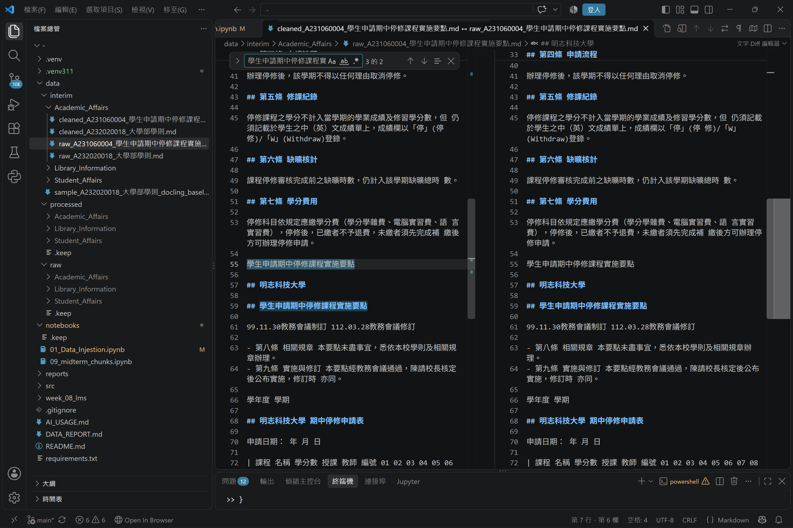

# 資料前處理報告 (Data Preparation Report)

> 期中評量 · NLP 自然語言處理 115-S1  
> 繳交版本：階段性成果，後續持續補齊

- **學號 / 姓名**：U12627003 / 王威翔
- **專案名稱**：PDF 資料輸入與前處理
- **完成的任務**：
  - [x] 1-A 頁首頁尾清除：完成程式與基本測試
  - [x] 1-B 雙語標題合併：完成程式、測試及問題分析
  - [x] 1-C 雙語條文合併：完成程式與基本測試
  - [ ] 完整批次處理與評估指標驗證

---

## 1. 資料集概覽 (Dataset Overview)

本次作業使用學校規章 PDF 作為自然語言處理的原始資料，依照文件性質分為三個類別。

| 類別 (Cluster) | PDF 數量 | 清洗前 chunk 數 | 清洗後 chunk 數 |
|---|---:|---:|---:|
| Academic_Affairs | 3 | 55（已處理 2 份） | 37（已儲存舊版結果） |
| Library_Information | 3 | 待完成 | 待完成 |
| Student_Affairs | 3 | 待完成 | 待完成 |
| **合計** | **9** | **55（目前已儲存）** | **37（目前已儲存）** |

以上數字來自目前已產生的 JSON 檔案，並非全部九份 PDF 的完整統計。

目前已處理的文件包括：

1. `A231060004_學生申請期中停修課程實施要點.pdf`
2. `A232020018_大學部學則.pdf`

其中：

| 文件 | Raw chunks | 已儲存 Cleaned chunks |
|---|---:|---:|
| 學生申請期中停修課程實施要點 | 12 | 12 |
| 大學部學則 | 43 | 25 |
| **合計** | **55** | **37** |

### 清洗後 chunk 數量變少了多少？是哪個任務造成的？

以目前已儲存的兩份文件為例，Raw 共 55 個 chunks，Cleaned 共 37 個 chunks，減少 18 個，約 32.73%。

但在重新執行《大學部學則》的現行清洗程式時，得到不同結果：

| 階段 | Chunk 數量 |
|---|---:|
| Raw | 43 |
| 1-A 後 | 40 |
| 1-B 後 | 40 |
| 1-C 後 | 40 |

這代表現行程式中的 1-A 使 chunk 減少 3 個，而 1-B、1-C 在此文件中沒有進一步改變 chunk 數量。

本次切塊使用：

```python
chunking_regex = r"\n(?=##\s)"
```

也就是遇到 Markdown 二級標題 `##` 時建立新的 chunk。

因此，當清洗移除二級標題，或將兩個二級標題合併成一個時，chunk 數量可能減少。

1-C 主要處理條文內容，不一定會修改二級標題，所以可能不影響 chunk 數量。

另外，目前重新清洗得到 40 chunks，但已儲存的 Cleaned JSON 為 25 chunks，代表不同版本的清洗結果尚未一致，後續需要重新執行完整流程並統一統計。

---

## 2. 清洗步驟 (Cleaning Steps)

本次使用 Python 正則表示式進行三項清洗任務，並透過 VS Code 的 Compare 功能，比較真實 Raw 與 Cleaned Markdown 檔案。

### 2.1 任務 1-A：頁首頁尾溢出清除

- **檢查檔案**：`cleaned_A231060004_學生申請期中停修課程實施要點.md`
- **搜尋文字**：`學生申請期中停修課程實施要點`
- **檢查截圖**：



#### 改變了什麼？

1-A 使用正則表示式，根據 PDF 檔名動態取得文件標題，嘗試移除轉換過程中重複出現的文件名稱。

程式使用 `(?m)` 多行模式，使 `^` 可以匹配每一行的開頭，而不只是整份文字的開頭。

這樣能針對獨立成行的重複文件名稱進行清除。

本次測試《大學部學則》時，1-A 使 chunk 數量由 43 減少至 40，表示部分原本形成獨立 chunk 的標題已被移除。

但在已儲存的《學生申請期中停修課程實施要點》Cleaned Markdown 中，仍觀察到重複文件名稱，代表目前清洗效果尚未完全一致。

#### 這對之後的問答檢索有什麼幫助？

移除重複的文件標題，可以減少無關文字佔用 chunk 空間，避免問答系統反覆檢索到相同的文件名稱，而忽略真正重要的條文。

#### 有沒有改錯的地方？

目前尚未確認 1-A 是否誤刪必要內容。

不過，已確認部分已儲存檔案仍存在未清除的重複標題，後續需要重新驗證清洗規則及輸出版本。

**正式 1-A 成功案例截圖尚待補齊：**


---

### 2.2 任務 1-B：雙語標題合併

- **檔名**：`cleaned_A232020018_大學部學則.md`
- **搜尋文字**：`明志科技大學`、`Ming Chi University of Technology`
- **截圖**：


#### 改變了什麼？

1-B 主要處理中文與英文標題被拆成不同 Markdown 行的問題。

例如原始資料可能出現：

```text
## 明志科技大學

## Ming Chi University of Technology
```

理想的合併結果為：

```text
## 明志科技大學 / Ming Chi University of Technology
```

這次實際檢查《大學部學則》時，發現原本的 1-B 正則表示式無法處理中英文標題之間存在空白行的情況。

因此另外測試了改善版正則表示式：

```python
safe_merge_regex = (
    r"(?m)^(##[ \t]+[^\r\n]*[\u4e00-\u9fff][^\r\n]*)"
    r"(?:\r?\n[ \t]*)+"
    r"##[ \t]+([A-Za-z][^\r\n]*)"
)
```

這個版本除了允許空白行，也要求前方標題包含中文、後方標題以英文字母開頭，降低錯誤合併的可能性。

實際測試結果：

| 測試方式 | Chunk 數量 |
|---|---:|
| 原本 1-B | 40 |
| 未限制語言的改善測試 | 23 |
| 加入中英文判斷的安全版 | 24 |

安全版成功合併 16 組雙語標題。

例如：

```text
## 第一篇 總則 / Part 1 General Provisions
## 第二章 繳費、註冊、選課 / Chapter 2 Payment of Fees, Registration and Course Selection
## 第三章 修業年限、學分、成績 / Chapter 3 Period of Study, Credits and Academic Grades
## 第四篇 學籍管理 / Part 4 Student Registration Management
## 第五篇 附則 / Part 5 Supplementary Provisions
```

上述結果是改善版的測試結果，尚未全面套用到全部九份 PDF。

#### 這對之後的問答檢索有什麼幫助？

合併中英文標題後，同一個章節的中文與英文名稱可以保留在同一個 chunk 中。

使用者不論使用中文或英文關鍵字搜尋，都更容易找到對應章節，也能減少只有標題而缺乏正文的短 chunk。

#### 有沒有改錯的地方？

目前列出的 16 組標題沒有發現明顯不對應的合併。

但這不代表所有文件都沒有誤合併，仍需在完整批次處理後檢查其他文件。

此外，安全版只針對中文標題在前、英文標題在後的形式，對其他排列方式可能無法處理。

---

### 2.3 任務 1-C：雙語條文合併

- **檔名**：`cleaned_A232020018_大學部學則.md`
- **搜尋文字**：`Article 15`
- **比較截圖**：


#### 改變了什麼？

1-C 的目的是整理中文條文與對應英文 Article 內容，避免 PDF 轉換後產生不必要的斷行或分離。

例如中文「第十五條」與英文 `Article 15` 應該保持清楚的對應關係。

本次已完成 1-C 的基本測試。

在《大學部學則》的實際比較畫面中，左右兩邊都能找到第十五條與 Article 15，但目前主要觀察到排版差異，尚未能單憑該截圖確認具體的合併效果。

#### 這對之後的問答檢索有什麼幫助？

中文與英文條文如果保持正確的對應關係，問答系統就能取得較完整的法規內容，降低因語言分離而產生不完整回答的風險。

#### 有沒有改錯的地方？

目前尚未從這張實際比較截圖確認 1-C 有誤合併或誤刪除的情況，但也尚未完成全部文件的驗證。

後續應檢查條文編號與英文 Article 編號是否一致。

---

### 清洗前後比較心得

這次作業讓我發現，PDF 成功轉換成文字，不代表文字結構一定正確。

例如中英文標題可能因空白行而分開，文件名稱可能重複出現，條文也可能因排版而失去原本的對應關係。

我原本認為只要正則表示式能正常執行，就代表資料清洗成功。

但在比較《大學部學則》的 Raw 與 Cleaned 檔案時，我發現不同版本竟然出現 25、40、24 chunks 等不同結果。

這讓我理解，清洗品質不能只用 chunk 數量判斷，更需要確認文字是否被正確保留、標題是否合併合理，以及輸出版本是否一致。

---

## 3. 評估指標與 AI 解讀查證 (Metrics & Verifying the AI's Interpretation)

### 3.1 指標數據表

本次評估包含中位數長度、拓撲錨定率、深度變異量及資訊熵。

| 指標 | Raw | Cleaned（我的） | Cleaned（參考值） |
|---|---|---|---|
| [1] 中位數長度 Median Length | 待產生 | 待產生 | 待老師公布 |
| [2] 拓撲錨定率 TAR | 待產生 | 待產生 | 待老師公布 |
| [3] 深度變異量 SDV（選填） | 待產生 | 待產生 | 待老師公布 |
| [4] 中位數資訊熵 Entropy（選填） | 待產生 | 待產生 | 待老師公布 |

目前專案根目錄尚未產生 `metrics.json`。

由於完整九份 PDF 的批次處理尚未完成，因此本階段不填入未經確認的指標數值。

### 儀表板截圖

待完整執行 `01_Data_Ingestion.ipynb` 第 6 節後補上。


### Cleaned 結果與參考值一致嗎？

目前尚未取得完整評估指標及老師公布的參考值，因此無法確認是否一致。

---

### 3.2 AI 的解讀

- **使用的 AI 工具**：ChatGPT（OpenAI）

本次已使用 ChatGPT 協助分析清洗規則與 chunk 數量變化，但尚未完成正式儀表板的 AI 解讀。

以下為目前針對清洗流程的階段性分析，並非儀表板四項指標的正式解讀：

> 目前《大學部學則》的 Raw 為 43 chunks，原本清洗程式產生 40 chunks。改善雙語標題合併規則後，測試結果為 24 chunks。
>
> 這代表 Markdown 二級標題的數量會直接影響目前的切塊結果。
>
> 不過，chunk 數量減少不一定表示資料品質提升，仍須確認是否發生錯誤合併或重要內容遺失。

正式儀表板解讀將於 `metrics.json` 與 `dashboard.png` 產生後補上。

---

### 3.3 你的查證（至少兩點）

#### 查證 1

- **AI 的說法**：Markdown 二級標題的數量會影響 chunk 數量。
- **我查了什麼**：《大學部學則》的清洗程式、`chunking_regex` 與測試結果。
- **結論**：正確。

目前切塊規則為：

```python
chunking_regex = r"\n(?=##\s)"
```

在同一份測試資料中，原本清洗結果為 40 chunks，安全版標題合併後為 24 chunks，剛好減少 16 個。

這與安全版成功合併 16 組雙語標題的結果一致。

#### 查證 2

- **AI 的說法**：chunk 數量減少不一定代表清洗品質比較好。
- **我查了什麼**：《大學部學則》原版、改善版與已儲存的 Cleaned 檔案。
- **結論**：正確。

本次測試出現以下結果：

- 原本清洗：40 chunks。
- 未限制語言的改善測試：23 chunks。
- 加入中英文判斷的安全版：24 chunks。
- 舊版已儲存結果：25 chunks。

其中，未限制語言的版本雖然產生最少的 chunks，但可能將不應合併的標題連接起來。

因此不能只看 chunk 數量，還需要檢查實際內容。

以上是對清洗流程的查證；正式依據儀表板解讀進行的兩項查證，仍待補齊。

---

### 3.4 實際證據：你被指定的 chunk

- **學號**：U12627003
- **SEED**：1106
- **指定 Notebook**：`09_midterm_chunks.ipynb`

#### (a) 很長的 chunk

- **資料檔（JSON）**：待執行 Notebook 取得
- **位置（從 0 開始）**：待取得
- **長度**：待取得
- **驗證碼**：待取得
- **閱讀用 Markdown**：待取得
- **起始行號**：待取得

**前 3 行內容：**

待取得指定 chunk 後填入。

**這是什麼樣的文字？為什麼會這麼長？**

需根據指定 chunk 的完整內容確認。

如果一個 chunk 包含多個條文、表格或過長的段落，就可能產生較高的字元長度。

**對問答檢索的影響：**

過長的 chunk 可能包含多個主題，使檢索結果不夠精確，也會增加模型處理的文字量。

後續可以考慮依條文編號、章節結構或適當長度進一步切分。

#### (b) 資訊熵很低的 chunk

- **資料檔（JSON）**：待執行 Notebook 取得
- **位置（從 0 開始）**：待取得
- **資訊熵**：待取得
- **驗證碼**：待取得
- **閱讀用 Markdown**：待取得
- **起始行號**：待取得

**完整內容：**

待取得指定 chunk 後填入。

**為什麼資訊熵低？對問答檢索有用嗎？**

資訊熵較低可能與文字重複、固定格式或符號比例較高有關。

不過，資訊熵低不代表內容沒有價值。例如短篇法規條文雖然用字重複，仍可能包含重要規定。

是否適合保留，必須根據實際指定 chunk 的內容判斷。

---

## 4. 一個尚未解決的問題 (One Remaining Problem)

### 問題：清洗後仍殘留重複文件標題

- **檔名**：`cleaned_A231060004_學生申請期中停修課程實施要點.md`
- **檢查位置**：第 55～59 行附近
- **搜尋文字**：`學生申請期中停修課程實施要點`
- **問題類型**：頁首頁尾或重複文件名稱未完全清除

### 我是怎麼找到的？

我使用 VS Code 的 Compare 功能，比較：

```text
raw_A231060004_學生申請期中停修課程實施要點.md
cleaned_A231060004_學生申請期中停修課程實施要點.md
```

接著搜尋文件名稱，發現在第 55～59 行附近，Cleaned 仍然保留與 Raw 相同的重複文件標題。

### 問題截圖


### 問題 chunk（部分內容）

```text
學生申請期中停修課程實施要點
```

上述為實際搜尋到的重複標題文字。完整 chunk 的標題、起始行號與上下文仍需進一步核對。

### 問題是什麼？

1-A 原本應該清除 PDF 轉換後重複出現的文件名稱，但在已儲存的 Cleaned Markdown 中仍可以找到重複標題。

這表示目前清洗結果尚未完全符合預期。

### 可能的原因

目前使用的 1-A 清洗規則會根據 PDF 檔名建立正則表示式。

如果 Markdown 中的文件名稱存在額外空白、不同格式或標題層級差異，可能導致匹配失敗。

另外，已儲存 Cleaned 檔案與目前重新執行的程式結果不一致，也可能是不同版本輸出造成的問題。

目前尚無足夠證據確認唯一原因。

### 具體修正方法

我認為可以採取以下方法：

1. 統一文件名稱中的空白與換行格式。
2. 在刪除重複標題前，確認它是否為獨立成行的文件名稱。
3. 將第一次出現的正式文件標題與後續重複頁首分開處理。
4. 增加清洗前後的比對測試，避免誤刪真正的章節標題。
5. 重新執行批次處理，確保 Markdown 與 JSON 使用同一版本的清洗程式。

### 對問答檢索的影響

如果重複文件標題沒有清除，可能造成某些 chunk 只有標題或包含過多重複資訊。

這會降低檢索結果的有效性，使問答系統取得較多無關內容。

因此，資料清洗除了移除重複資訊，也必須確保保留必要的章節結構與條文內容。

本問題後續還需確認是否與第 3.4 節指定的兩個 chunk 重複；正式提交時應選擇不同的 chunk。

---

## 5. AI 協作 (AI Collaboration)

本次作業的 AI 協作紀錄請見 [`AI_USAGE.md`](AI_USAGE.md) 的 Week 04 / 08 與 Week 09 段落。

### 這次使用 AI 最大的收穫或教訓

這次使用 AI 最大的收穫，是學會如何利用 AI 協助分析正則表示式、檢查清洗結果，以及找出程式與資料之間的不一致。

其中讓我印象最深刻的是 1-B 雙語標題合併任務。

原本我以為只要把中文與英文標題連接起來，就能完成資料清洗。但實際執行時，我發現中英文標題之間如果存在空白行，原本的正則表示式就可能無法成功匹配。

我先透過 Notebook 比較清洗前後的 chunk 數量，發現《大學部學則》原本有 43 chunks，清洗後仍有 40 chunks。

接著，我嘗試讓正則表示式允許空白行，測試結果變成 23 chunks。

不過，進一步檢查後發現，這個版本可能把不應合併的標題連在一起，而且合併後還會出現多餘的 `##` 符號。

因此，我再加入中文與英文的判斷條件，讓正則表示式只匹配中文標題在前、英文標題在後的形式。

改善後成功合併 16 組雙語標題，得到 24 chunks。

這讓我理解，資料清洗並不是 chunk 越少越好，而是要確保每個 chunk 保留正確的結構與語意。

另外，我也發現 AI 提供的程式碼不能直接視為正確答案。

例如之前測試 1-C 時，曾經因為使用不存在的變數 `step_3_text` 而發生 NameError。

這讓我學會在使用 AI 建議時，必須先確認變數名稱、理解程式用途，再透過實際執行結果驗證。

我也透過 VS Code 的 Compare 功能，比較真實 Raw 與 Cleaned Markdown 檔案，發現《學生申請期中停修課程實施要點》清洗後仍有重複文件標題。

這讓我知道，即使 Notebook 的基本測試成功，也不代表全部真實 PDF 都已正確清洗。

未來如果要建立問答檢索系統，我會更加重視清洗規則的適用範圍、輸出版本的一致性，以及是否保留原始文件的重要資訊。

我認為 AI 最有幫助的地方，是提供分析方向與可能的修正方式；但最終仍然需要自己檢查資料、執行測試並確認結果。

---

## 階段性完成狀態

本次已完成：

- 三類資料集、九份 PDF 的檔案數量確認。
- 1-A、1-B、1-C 清洗程式及基本測試。
- 兩份 PDF 的 Raw／Cleaned JSON 輸出。
- 《大學部學則》的清洗差異分析。
- 1-B 改善版的 16 組雙語標題合併測試。
- 真實 Markdown 比較截圖及殘留問題分析。
- AI 協作與學習心得。

尚待完成：

- 其餘七份 PDF 的完整批次處理。
- 統一現行清洗程式與已儲存輸出。
- 1-A 的正式成功案例截圖。
- `metrics.json` 與四圖儀表板。
- 第 3.2 節正式 AI 儀表板解讀。
- 第 3.3 節對儀表板解讀的查證。
- 第 3.4 節指定 chunk、完整內容及驗證碼。

本報告為期中作業的階段性成果，未完成項目將於後續版本補齊。
